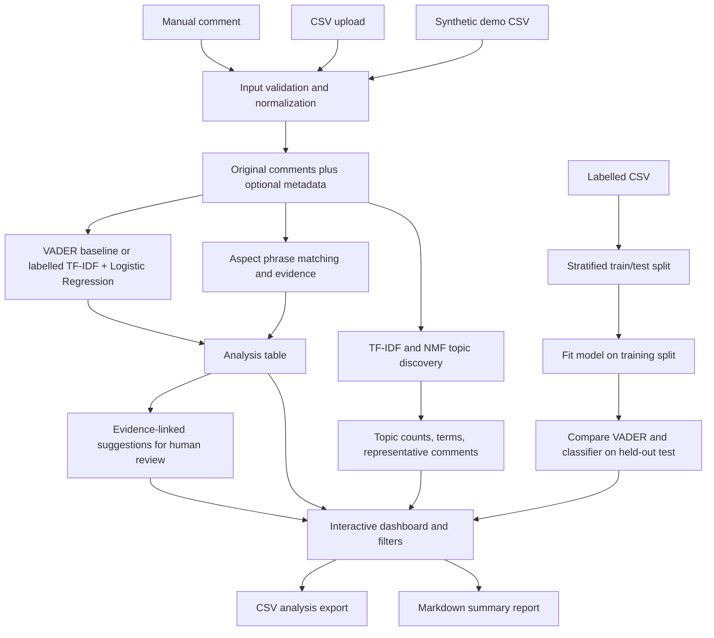

# CampusVoice architecture

The Streamlit process performs local computation. VADER lexicon resource availability is checked at runtime; NLTK downloads its small lexicon if absent. Topic extraction uses scikit-learn. No student comments are sent to a cloud model.
